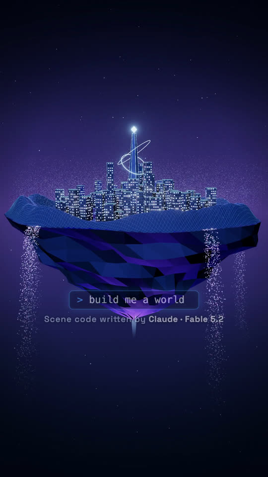

# claude-fable-3d-world

A floating island city that builds itself in your browser — terrain, towers, lit windows, traffic and 40,000 particles — drawn entirely by code. No imported 3D models or textures.

The scene code was written by **Claude (Fable 5.2)**. The project started with the prompt `build me a world` and was then refined step by step. It recreates the animation from a 33-second vertical Short as a live WebGL scene, so instead of only watching it you can take over the camera and explore.

<p align="center">
  <br>
  <sub>A frame from the rendered 33-second video (not a live capture). The live scene recreates this animation in your browser and lets you explore it interactively.</sub>
</p>

## Run it

Requirements: **Node.js 20 or newer** (with npm) and a browser with WebGL2, such as a current Chrome, Edge, Firefox or Safari.

```bash
git clone https://github.com/cdurgun/claude-fable-3d-world.git
cd claude-fable-3d-world
npm install
npm start
```

Open <http://127.0.0.1:4173/>.

`npm start` runs a tiny static file server (`scripts/serve.mjs`, no dependencies). Three.js is loaded from `node_modules` through an import map, so there is no bundler and no build step.

### Interact

| Input | Action |
|---|---|
| Wait | The film plays for about 33 seconds, then loops |
| Drag | Take over the camera and orbit |
| Scroll / pinch | Zoom |
| `R` | Hand the camera back and replay the film |
| `C` | Toggle narration captions (off by default, since the live scene has no audio) |

The 1080×1920 portrait stage is scaled to fit your window. Add `?particles=20000` to the URL to change the particle count.

### Test

```bash
npm test
```

Launches **Google Chrome** with Playwright (the test uses the installed Chrome, `channel: 'chrome'`, so Chrome must be installed; no browser download happens). It checks that the scene plays, then drags and scrolls to confirm the camera really moves, and takes about 30 seconds. Running the scene itself does not need Playwright or Chrome specifically.

## Try it: change one number

The mountains come from a single line in `scene/main.js`:

```js
const y = rim * (2 + 9 * fbm(x * 0.06, z * 0.06));
```

1. Open `scene/main.js` and find `terrainHeight`.
2. Change the `9` to `0` (the peaks flatten out) or `25` (towering peaks).
3. Save and reload the page.

`fbm` adds up four layers of noise, each finer and fainter than the one before.
The `9` only scales how tall the result gets.

## How it works

Everything on screen is a **pure function of time `t`**. A single `update(t)` positions every object, sets every shader uniform and picks the camera pose, so the scene is deterministic: the same `t` always gives the same frame. All randomness comes from a seeded generator (`mulberry32`), so the world is identical on every run.

### Procedural terrain

- A 141 × 141 vertex grid covers a 130-unit square. Only vertices inside a wobbly circular outline (`edgeRadius`, a sum of sines) become part of the island.
- Height comes from **fractal value noise** (`fbm`: four octaves of hashed, smoothly interpolated lattice noise). A radial mask keeps a flat plateau for the city, lets hills rise around it, and flattens again at the cliff edge.
- The solid mesh and the glowing wireframe **share one position buffer**. At the start the grid is flat and revealed by an expanding shader pulse; then each vertex rises to its target height with an `easeOutBack` overshoot, delayed by its x position so the rise sweeps across the island.
- The rock hanging underneath is a ring-by-ring surface that narrows with depth, roughened with the same noise.

### Towers, windows and the spire

- 64 towers are placed by **rejection sampling**: random ring position and size, rejected if it overlaps another tower or sits near the camera's flight path.
- All towers are one `InstancedMesh` (one draw call). Each grows from the ground with `easeOutBack`, staggered by distance from the center.
- Windows are **not textures**. The standard material is patched with `onBeforeCompile` to compute a window grid from object-space position, darken unlit panes, and light a pseudo-random subset with blue, violet or white emission. Lights switch on in a wave spreading outward from the central spire. Far away, the pattern fades to an average to avoid shimmering.
- The central spire is a hexagonal prism with an emissive edge outline, a rotating beacon and two orbiting halo rings.

### Lighting and shadows

A hemisphere light and a violet rim light give the base look. A directional key light casts a 4096² PCF shadow map and swings around the city mid-film so shadows sweep across it. Point lights glow from the spire and from under the island. Tone mapping is ACES filmic, and the result goes through an `EffectComposer` with a 4× multisampled half-float target, `UnrealBloomPass`, and `OutputPass`.

### Traffic

Two ring roads carry ~130 cars. Each car is a short trail of 16 points, and **no car position is ever computed on the CPU**: the vertex shader derives each point's angle from `phase + speed × time`, offsets it backwards along the road for the trail, and fades the tail. Opposite directions are colored differently.

### The 40,000 particles

The dust cloud is a single `THREE.Points` with 40,000 vertices. Each carries a few random numbers (its "seed") and **all motion happens in the vertex shader**: the particle lifts off in a wave, rises, drifts with a wind vector and sways with sine noise, then fades and loops. The CPU only updates one `uTime` uniform per frame. The same technique drives the light "waterfalls" off the island rim (7,000 points), the 2,600 stars, and the 1,500 falling code glyphs, which sample a character atlas drawn at startup on a 2D canvas.

### Three.js, WebGL and shaders

Three.js provides the renderer, scene graph, geometry and post-processing; WebGL does the drawing. Custom GLSL is used for the sky gradient, the terrain pulse, the particle systems, the traffic, the window emission and the light beam. Points are rendered additively with a soft circular falloff, which bloom then turns into glow. The camera follows a **cubic Hermite spline** through timed keyframes, with `OrbitControls` taking over on first interaction.

## Project layout

```
LICENSE                  MIT license for this project's own code
THIRD_PARTY_LICENSES.md  third-party notices
scene/index.html         page, HUD styles, import map
scene/main.js            the whole scene (~670 lines)
data/timeline.json       word timings used for the on-screen captions
assets/screenshot.jpg    README image (a frame from the video)
assets/fonts/            Space Grotesk 500 / 700 (woff2) and its OFL.txt
scripts/serve.mjs        dependency-free static server
scripts/check-live.mjs   browser test
```

Notes:

- The captions are timed to a narration track from the original video. The audio is not included, so captions are off by default in the live scene; press `C` to show them.
- The video-rendering pipeline (frame capture, narration, music, FFmpeg) is not part of this repository.

## Attribution

Scene code written by **Claude (Fable 5.2)**, Anthropic's model. The project began with the prompt `build me a world` and was refined from there.

## Licenses

The original source code in this repository is released under the [MIT License](LICENSE).

Third-party components keep their own licenses, which the MIT license above does not change or override. See [THIRD_PARTY_LICENSES.md](THIRD_PARTY_LICENSES.md).

| Component | License |
|---|---|
| [three.js](https://threejs.org) (npm dependency) | MIT |
| [Playwright](https://playwright.dev) (dev dependency, tests only) | Apache-2.0 |
| Space Grotesk fonts in `assets/fonts/` | SIL Open Font License 1.1, see [assets/fonts/OFL.txt](assets/fonts/OFL.txt) |
